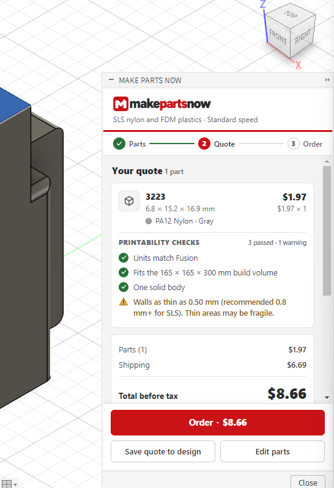
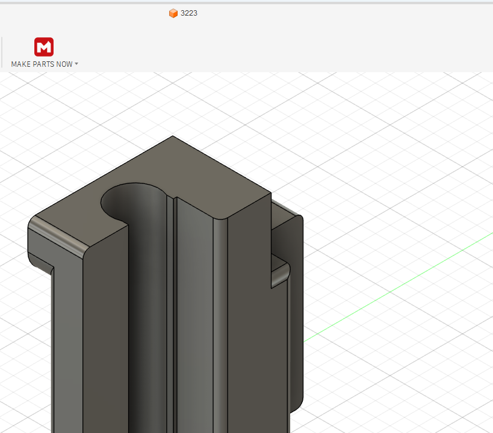
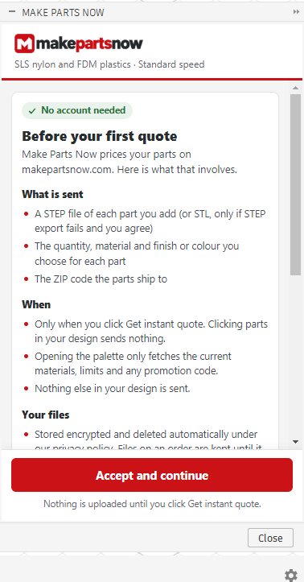

# Make Parts Now for Autodesk Fusion: instant 3D printing quotes

A free add-in for Autodesk® Fusion® (Fusion 360) on Windows that prices 3D printing for the parts you click, right
inside Fusion. Choose SLS PA12 nylon (Gray or Black Dyed) or an FDM plastic (PLA, PETG, ABS, ASA, TPU 95A, PA-CF,
PETG-CF) for each part, see the price, a printability checklist and the ship date in seconds, then order on
[makepartsnow.com](https://makepartsnow.com). No account, no sign-in, no order minimum. Parts are made in the US.

## Install

**From the Autodesk App Store** (the listing is in Autodesk's review): search for "MakePartsNow" and install it. Fusion loads it by itself.

**Manually:** download `MakePartsNow-<version>.zip` from [Releases](../../releases/latest) (or from this repository's
root), then:

1. Unzip it anywhere you'll keep it, for example `Documents\MakePartsNow`. You get a `MakePartsNow` folder holding
   `MakePartsNow.manifest`.
2. In Fusion, open **UTILITIES > ADD-INS > Scripts and Add-Ins**, click **+** > **Script or add-in from device** and
   choose that folder. Turn on **Run**, and tick **Run on Startup** to keep it loaded.
3. In the Design workspace, open the **UTILITIES** tab and click **Get Instant Quote** in the **MAKE PARTS NOW** panel.

`MakePartsNow-<version>.bundle.zip` is the Autodesk App Store package of the same version.

**Uninstall:** stop it in **Scripts and Add-Ins** and delete the `MakePartsNow` folder (or uninstall it from the App
Store). To remove its settings too, delete `%APPDATA%\MakePartsNow`.

## How to get a quote

1. Click **Get Instant Quote**. The Make Parts Now palette opens on the right.
2. Click up to 25 parts in your design: components in the browser or canvas, or a body or face of one. Each part must
   be one solid body in its own component.
3. Pick a material, a finish or colour and a quantity for each part, enter the US ZIP code the parts ship to, and click
   **Get instant quote**. You see each part's price, the checks (units match Fusion, fits the build volume, one solid
   body, thin walls), shipping, the total before tax and the delivery dates.
4. **Order** opens checkout on makepartsnow.com in your browser. You pay there through Stripe; the add-in never sees
   card details. **Save quote to design** keeps the quote with your parts.

## What leaves your computer

Nothing is sent until you accept the consent text (once) and click **Get instant quote**. Clicking parts sends nothing.

For a quote it sends, to makepartsnow.com only: one STEP file per part (or STL, only if STEP export fails and you
agree), with your name, company and file path removed from the STEP header; the quantity, material and finish you
chose; and the ZIP code. Anonymous usage counts are sent only if you tick that box. **Delete my uploaded files** in the
palette removes your uploads. Details: [PRIVACY.md](PRIVACY.md) and the
[privacy policy](https://makepartsnow.com/legal/privacy).

## Help and support

Help: <https://makepartsnow.com/fusion>. Email nathan@makepartsnow.com. Security issues: [SECURITY.md](SECURITY.md).
Changes: [CHANGELOG.md](CHANGELOG.md).

## License

MIT ([LICENSE](LICENSE)). Make Parts Now is not affiliated with Autodesk. Autodesk and Fusion are registered trademarks
or trademarks of Autodesk, Inc., in the USA and other countries.
